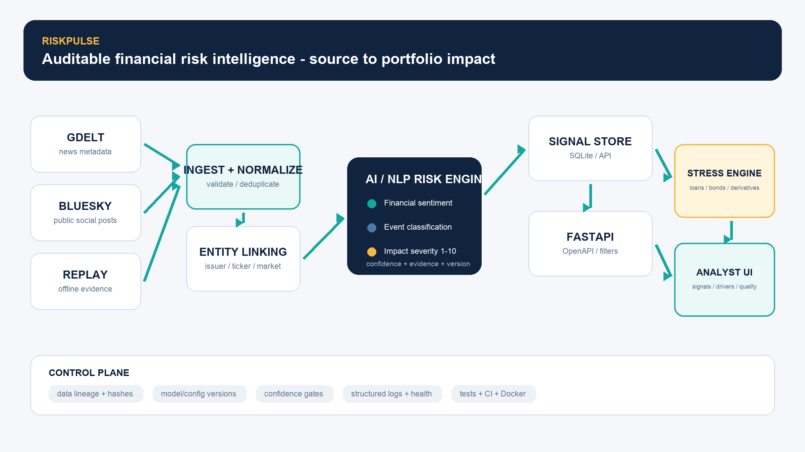
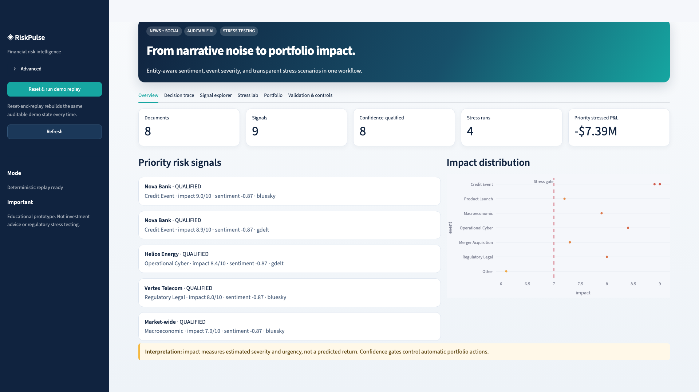

# RiskPulse - S&P Global & Crisil Campus Hackathon 2026

**Candidate Name:** Alok Chandra<br>
**College Email ID:** `[REPLACE WITH COLLEGE EMAIL]`<br>
**College / Campus:** `[REPLACE WITH COLLEGE NAME]`<br>
**Demo Video Link:** `[ADD UNLISTED YOUTUBE LINK]`<br>
**Slide Deck:** [docs/presentation.pdf](docs/presentation.pdf)

> Educational prototype. RiskPulse is not investment advice and is not a regulatory stress-testing system.

## 1. Project Overview / Problem Statement & Approach

Financial risk teams face more unstructured information than they can review consistently. News and
social posts arrive with different formats, repeated coverage, ambiguous entities, and no direct link
to portfolio exposure. RiskPulse turns that narrative stream into an auditable contract: financial
sentiment from `-1` to `1`, an explicit financial-event category, and an explainable severity score
from `1` to `10`.

The platform processes GDELT-shaped news and Bluesky-shaped social text through one pipeline. A
deterministic offline replay makes the result reproducible; optional live adapters use the same code
path. Signals carry confidence, evidence, provenance, reason codes, model versions, and idempotency
keys. When a confidence-qualified signal has a direction-compatible supported scenario and impact
strictly greater than `7`, RiskPulse automatically runs a transparent stress against a synthetic
portfolio of loans, bonds, and derivatives. The dashboard connects the original narrative to
portfolio loss drivers without manual data transfer.

## 2. Architecture & Tech Stack



The implementation is a modular Python monolith: source adapters → normalization/deduplication →
entity linking → sentiment/event/impact analysis → SQLite signal store/API → automatic stress engine
→ Streamlit dashboard. This structure is simple to run for judges while retaining testable module
boundaries.



- Python 3.11, FastAPI, Pydantic, SQLAlchemy, SQLite
- HTTPX adapters for GDELT and Bluesky; deterministic JSONL replay
- Finance lexicon offline model and optional `ProsusAI/finbert` backend
- Versioned rule-based event taxonomy with explicit abstention
- Explainable seven-factor impact score and confidence gates
- Streamlit, Plotly, and pandas dashboard
- pytest, coverage, Ruff, mypy, GitHub Actions, Docker Compose

As-built design and requirement evidence: [docs/as_built.md](docs/as_built.md)<br>
Original planning artifact: [project_implementation_plan.md](project_implementation_plan.md)<br>
Model card: [docs/model_card.md](docs/model_card.md)<br>
Assumptions: [docs/assumptions.md](docs/assumptions.md)<br>
Jury Q&A brief: [docs/jury_qa.md](docs/jury_qa.md)

## 3. Dataset Used

Every committed runtime dataset is synthetic, compact, redistributable, and documented in
[data/README.md](data/README.md). No confidential or real client data is used.

- 9 mixed-source replay records, including an exact duplicate to verify idempotency
- 10 fictional companies with aliases and cashtags
- 72 fictional wholesale positions: 32 loans, 24 bonds, and 16 derivatives
- 15 finance-sentiment and 20 event/impact evaluation examples
- SHA-256 provenance manifest at `data/manifests/data_manifest.csv`

Live source content is optional and is written only to Git-ignored runtime storage. Synthetic records
are clearly labeled and never represented as real GDELT/Bluesky content.

## 4. Quickstart & Installation

Runtime: **Python 3.11**. Tested on macOS; CI tests Linux on GitHub Actions.

```bash
git clone <your-public-repository-url>
cd <college>-<candidate-name>-hackathon
make setup
make seed
make doctor
make demo
```

Start the API:

```bash
make api
```

In another terminal, start the dashboard:

```bash
make dashboard
```

Open:

- Dashboard: <http://127.0.0.1:8501>
- Interactive API documentation: <http://127.0.0.1:8000/docs>
- Readiness: <http://127.0.0.1:8000/readyz>

### Direct commands without Make

```bash
python3.11 -m venv .venv
.venv/bin/python -m pip install -r requirements-dev.txt
.venv/bin/python scripts/generate_portfolio.py
.venv/bin/python scripts/update_data_manifest.py
.venv/bin/python scripts/validate_data.py
.venv/bin/python -m riskpulse.cli replay --fixture data/demo/mixed_source_events.jsonl
.venv/bin/uvicorn riskpulse.api.app:create_app --factory --port 8000
```

### Docker Compose

```bash
docker compose up --build
```

### Optional FinBERT backend

The default `auto` mode uses FinBERT when its optional dependencies and weights are prepared; it
otherwise selects the tested offline finance lexicon.

```bash
make models
RISKPULSE_MODEL_BACKEND=finbert make demo
```

Model downloads are disabled by default during application startup. The five-minute demo never
downloads weights.

### Optional live ingestion

```bash
.venv/bin/python -m riskpulse.cli live --query 'financial markets'
# Or continuously poll both providers every five minutes:
make live
```

Live adapters use bounded exponential backoff for rate limits and transient provider errors. Live
operation still requires network availability and provider compliance; replay remains the official
reproducible evidence path.

## 5. Two-Minute Judge Path

1. Open the dashboard and press **Reset & run demo replay**. The sidebar proves `9` fetched, `8`
   unique, `1` duplicate, `9` signals, `4` stress runs, and `0` failures.
2. Open **Decision trace**. It defaults to Nova Bank: two independent news/social records resolve to
   one credit-event cluster and pass four visible policy gates.
3. Follow the linked credit scenario to `-$7.39M` (`-1.80%`) portfolio P&L, the top sector driver,
   and `$0.00` reconciliation error.
4. Open **Signal explorer** and select Orion Pharma to show honest `other` abstention, or inspect the
   unresolved-issuer safeguard that prevents an unknown company from becoming a market-wide shock.
5. Open **Validation & controls** for model/data limitations, impact MAE/correlation, lineage, and
   runtime readiness.

The complete timed narration and fallback path are in [docs/demo_script.md](docs/demo_script.md).

## 6. Key Results & Domain Impact

The committed replay currently produces:

- 9 fetched inputs, 8 unique documents, and 1 exact duplicate rejected
- 9 entity/event risk signals from news and social source shapes
- 4 distinct automatic stress runs with no duplicate trigger
- 72 reconciled position-level valuations across loans, bonds, and derivatives
- Zero replay failures
- Unknown issuer-specific events remain unresolved and cannot trigger full-portfolio stress

On the compact synthetic gold sets, the transparent offline baselines produce:

| Output | Samples | Reproducible evidence |
|---|---:|---:|
| Finance sentiment lexicon | 15 | 100.00% macro-F1 |
| Event taxonomy rules | 20 | 100.00% macro-F1 |
| Explainable impact score | 20 | MAE `1.15`; Pearson `r = 0.8521` |

These compact, vocabulary-constrained synthetic sets verify deterministic behavior on submitted
examples; they are **not production accuracy, calibration, or realized-market-impact claims**. The
impact comparison uses a fixed one-source/fully-relevant-entity protocol and human-specified severity
targets. Exact assumptions and per-event errors are in
[docs/results/model_metrics.json](docs/results/model_metrics.json).

RiskPulse demonstrates the domain workflow that matters: a risk analyst can move from an external
narrative to a confidence-gated, explainable signal and then to asset/sector/country portfolio loss
drivers without manual copying. The system also shows its uncertainty and refuses automatic action
when confidence or scenario applicability is insufficient.

## 7. Test and Quality Commands

```bash
make test       # automated unit, integration, API, and end-to-end checks
make coverage   # branch-aware coverage; release floor 85%
make quality    # formatting, linting, type checks, data validation
make evaluate   # reproducible synthetic-set model metrics
make release    # engineering release gate
make submission # strict final-metadata and deliverable gate
```

The test suite covers source mapping, malformed/duplicate handling, entity matching, NLP ranges,
impact components, API contracts, retry behavior, cross-source corroboration, strict trigger
boundaries, idempotency, all three asset classes, and portfolio reconciliation.

`make submission` additionally rejects placeholder identity/deck fields, a missing final GitHub clone
URL, a missing YouTube demo URL, and an invalid repository name. Public access still needs a manual
incognito-window check.

## 8. API Examples

Analyze a new text:

```bash
curl -X POST http://127.0.0.1:8000/api/v1/analyze \
  -H 'Content-Type: application/json' \
  -d '{"text":"Nova Bank downgraded after default and missed payment"}'
```

Query high-impact, confidence-qualified signals:

```bash
curl 'http://127.0.0.1:8000/api/v1/signals?min_impact=7&actionable=true'
```

## 9. Limitations and Responsible Use

- The submitted data and evaluation sets are intentionally compact and synthetic.
- Sentiment is document-level financial tone associated with each resolved signal, not a forecast
  return.
- Impact is modeled severity/urgency, not a predicted percentage price move.
- Source quality priors and scenarios contain documented modeling judgment.
- A standalone rate-cut narrative is blocked from selecting the configured adverse rate-rise shock.
- Social text can contain rumors, sarcasm, and manipulation.
- Demo event clustering uses entity, event class, a six-hour window, and matched-term overlap; it is
  a lightweight evidence heuristic rather than semantic production clustering.
- Exact-content duplicate suppression is bounded to 24 hours; provider record IDs remain globally
  idempotent in the demo store.
- Stress formulas are transparent approximations, not regulatory capital models.
- The repository must be personalized with candidate identity and the final public video/repository
  links before submission.

## 10. License and Acknowledgements

Source code and committed synthetic project data are released under the [MIT License](LICENSE).
External services and optional model weights retain their own terms. Material AI assistance should be
acknowledged honestly in the final submission, consistent with the hackathon guidelines.
