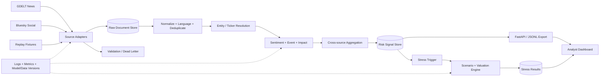

# Project Implementation Plan — RiskPulse

> **Working title:** RiskPulse — Real-Time Financial Risk Intelligence  
> **Project type:** S&P Global & Crisil Campus Hackathon 2026 submission  
> **Status:** Archived planning blueprint; see `docs/as_built.md` for shipped behavior
> **Source of truth:** `problem_statement.md` and `project_guidlines.md`  
> **Plan principle:** Build one excellent, measurable, reproducible end-to-end product before adding breadth.

---

## 1. Executive Direction

RiskPulse will ingest near-real-time financial news and social posts, convert unstructured text into auditable risk signals, and use high-impact events to run a transparent stress test against a synthetic wholesale-banking portfolio.

The strongest submission strategy is:

1. Build the mandatory AI/NLP Risk Engine completely.
2. Make **Module B: Strategic Portfolio Stress Testing** the flagship downstream application.
3. Implement **Module A: Tactical Index Rebalancing** only after every Core + Module B release gate passes.
4. Support both live ingestion and a deterministic replay mode. The jury demonstration must never depend on network availability, API keys, or a third-party service being healthy.
5. Report measured results, confidence, data lineage, model limitations, and financial assumptions. Do not present illustrative scores or simplified stress tests as production-grade predictions or regulatory stress testing.

Module B is the primary choice because it consumes both event classification and impact score, demonstrates stronger financial-risk domain understanding, and aligns directly with the first stated tie-breaker. Module A remains a valuable differentiator, but only as a gated stretch goal.

### 1.1 Key implementation decisions

| Area | Decision | Reason |
|---|---|---|
| Architecture | Python modular monolith with clear internal interfaces | Fast to build and demonstrate, easy to test, and avoids premature distributed-system complexity |
| Primary downstream module | Module B — Strategic Portfolio Stress Testing | Best use of the event and impact signals; strongest risk-management narrative |
| Live data sources | GDELT news plus Bluesky public posts | Two distinct source types: news and social; both have public read paths |
| Demo data source | Versioned, deterministic replay fixtures shaped exactly like live inputs | Reproducible and resilient to API outages or rate limits |
| Sentiment model | Finance-domain transformer, with a lightweight deterministic fallback | Strong domain baseline without making the demo dependent on model download/network |
| Event model | Rules baseline compared with a small supervised/embedding classifier and a zero-shot candidate | The release model is selected from evidence, not preference |
| Impact score | Explainable hybrid severity model, then calibrated against human labels or historical reaction data if feasible | Honest and inspectable when true impact ground truth is limited |
| Entity resolution | Curated company/ticker alias registry plus exact/cashtag matching; optional NER fallback | High precision for the bounded demo universe |
| Storage | SQLite through a repository abstraction | Zero-configuration demo with a clean upgrade path |
| API | FastAPI + Pydantic, versioned under `/api/v1` | Typed contracts and automatic OpenAPI documentation |
| Dashboard | Streamlit + Plotly | Rapid, polished, interactive Python-native dashboard |
| Packaging | Local one-command run plus Docker Compose | Reviewer-friendly and reproducible |
| Deployment | Local demo is mandatory; hosted demo is optional | Submission rules require a functional demonstration, not a production cloud platform |

This plan was written before implementation and is retained to show the design process. It includes
stretch goals and proposed acceptance checks that were intentionally not all shipped. The precise
as-built scope and evidence are documented in `docs/as_built.md`.

---

## 2. Product Goal and Definition of Done

### 2.1 Product goal

Give a risk analyst a single interface where they can:

1. Observe text arriving from news and social sources.
2. See the affected company or market entity.
3. Inspect entity-specific sentiment, event category, severity, confidence, provenance, and explanation.
4. Identify a high-impact event.
5. Trigger or inspect an automatically triggered stress scenario.
6. Understand the portfolio loss, affected exposures, assumptions, and largest risk drivers.

### 2.2 Mandatory definition of done

The project is complete only when all of the following are true:

- At least two distinct source adapters process text through the same pipeline.
- The committed replay dataset includes representative records from both source shapes.
- Every accepted record produces a validated, machine-readable output or a documented rejection reason.
- Every signal includes sentiment in `[-1.0, 1.0]`, one primary event label, and impact in `[1.0, 10.0]`.
- Signals include entity, timestamps, source, confidence, evidence, and model/version lineage.
- Signals are available through a documented API and JSONL/CSV export.
- A high-impact configured event automatically drives Module B with no manual data transfer.
- The synthetic portfolio contains loans, bonds, and derivatives.
- Stress-test results reconcile from pre-stress value to post-stress value.
- The dashboard shows signal history, source/model health, scenario assumptions, before/after value, loss, and exposure breakdowns.
- Replay mode completes end-to-end without network access after setup.
- Automated unit, contract, integration, data, and end-to-end tests pass.
- A fresh clone can be run using only the README instructions.
- The public repository contains the required license, data, diagram, 5–7 slide PDF, and public video link.
- The rehearsed primary demo completes in at most five minutes, satisfying the stricter timing requirement in the problem statement.

### 2.3 Quality definition of done

- No secret, personal data, confidential client data, or private endpoint is committed or visible in screenshots/video.
- All charts have titles, units, legends, accessible contrast, and non-color cues.
- Every reported model or system metric names its dataset, split, calculation, and limitations.
- The impact score and stress calculations expose their contributing factors and assumptions.
- Failures are graceful: one bad record or unavailable source cannot crash the system.
- The repository is clean, organized, reasonably sized, and has meaningful incremental commits.

---

## 3. Scope and Priority

### 3.1 P0 — must ship

- Common ingestion contract and two source adapters.
- GDELT news adapter.
- Bluesky social adapter.
- Offline fixture/replay adapter using the exact same downstream path.
- Normalization, validation, deduplication, and dead-letter handling.
- Company/ticker/entity resolution for a documented universe.
- Sentiment, event classification, impact scoring, confidence, and explanation.
- Versioned `RiskSignal` schema.
- SQLite persistence, API, JSONL export, and health endpoint.
- Synthetic loans/bonds/derivatives portfolio and deterministic scenario engine.
- Automatic `impact_score > 7` trigger for configured event types.
- Complete analyst dashboard.
- Evaluation harness, automated tests, and demo fixtures.
- README, LICENSE, data documentation, architecture diagram, slide deck, demo video, and submission checks.

### 3.2 P1 — competitive polish

- Cross-source event clustering and corroboration score.
- Source credibility and novelty features.
- Model confidence calibration.
- Historical event replay and a results comparison against baselines.
- Sensitivity analysis for stress assumptions.
- Model/data quality page and error/source-health visibility.
- Docker packaging, CI, dependency/security checks, and optional hosted read-only demo.
- Carefully documented model card, data card, architecture decisions, and limitations.

### 3.3 P2 — stretch differentiators

- Module A with bounded, turnover-aware sentiment tilts and backtesting.
- Multilingual ingestion/translation.
- Analyst feedback and manual label capture.
- Drift detection and scheduled evaluation.
- Alert delivery and richer streaming updates.
- PostgreSQL/Redis or a real queue only if measured scale requires them.

### 3.4 Explicit non-goals

- Production trading or automated trade execution.
- Investment advice or return guarantees.
- Regulatory capital, CCAR, ICAAP, or production-grade valuation claims.
- Use of real/confidential S&P Global, Crisil, bank, or client data.
- Scraping that violates provider terms.
- Training a large language model from scratch.
- Kubernetes, multiple deployable microservices, or complex infrastructure for demo-scale traffic.
- Storing full copyrighted news articles when title, summary, link, and derived features are sufficient.

---

## 4. Requirements Traceability

| ID | Requirement | Planned implementation | Acceptance evidence |
|---|---|---|---|
| CORE-01 | Ingest at least two sources | GDELT news + Bluesky social adapters; replay equivalents | Integration test ingests at least one record from each adapter |
| CORE-02 | Process unstructured text | Normalize headline, summary/body excerpt, and social post text | Validated `RawDocument`/`NormalizedDocument` records |
| CORE-03 | Analyze a company or event | Alias/cashtag entity linker plus an explicit unresolved state | Entity precision evaluation and entity shown in UI/API |
| CORE-04 | Sentiment score | `P(positive) - P(negative)`, clamped to `[-1, 1]` | Range/property tests and labeled evaluation |
| CORE-05 | Event classification | Versioned financial event taxonomy and release classifier | Macro-F1/confusion matrix and per-signal confidence |
| CORE-06 | Required example classes | Geopolitical, Macroeconomic, Credit Event, M&A, Product Launch | Taxonomy contract and one golden example per class |
| CORE-07 | Impact score | Explainable 1–10 severity score with factor breakdown | Range tests, rubric agreement, calibration report |
| CORE-08 | Machine-readable output | Pydantic JSON schema and JSONL/CSV export | Schema/contract tests |
| CORE-09 | Downstream consumption | `/api/v1/signals` plus internal event subscriber/repository | Module B consumes stored engine output automatically |
| CORE-10 | Real-time suitability | Async polling, bounded retries, timestamps, idempotency, and latency metrics | Replay/live smoke test and p95 latency report |
| B-01 | Consume event + impact | Module B accepts a `signal_id` and reads its event/impact fields | Integration test from signal to stress run |
| B-02 | Synthetic wholesale portfolio | Seeded generator and committed compact CSV | Schema validation and data documentation |
| B-03 | Loans, bonds, derivatives | Three asset classes with asset-specific risk attributes | Portfolio distribution visible in UI/test |
| B-04 | High-impact trigger | Configured event class and `impact_score > 7.0` | Boundary tests for 7.0, 7.01, and duplicates |
| B-05 | Configurable shocks | YAML scenario library and severity scaling | Scenario snapshot/golden tests |
| B-06 | Before/after value | Asset-level P&L rolled up to portfolio totals | Reconciliation test to within currency tolerance |
| B-07 | Visualization | Before/after KPIs, waterfall, asset/sector/country breakdown | UI checklist and screenshots |
| DEL-01 | Public source repository | Named `<college>-<candidate-name>-hackathon` | Incognito access check |
| DEL-02 | Functional demo | Scripted offline replay with optional live-source preview | Timed rehearsal at or below five minutes |
| DEL-03 | 5–7 slide deck | Seven-slide `docs/presentation.pdf` | Page count and link check |
| DEL-04 | All used data submitted | Compact CSV/JSON fixtures, synthetic portfolio, manifests | Data inventory matches runtime config |
| DEL-05 | Mandatory README/LICENSE | Required template fields, exact commands, MIT license unless changed | Fresh-clone run and release checklist |

Module A requirement tests are defined in Section 12 and apply only after the stretch goal is accepted into scope.

---

## 5. Domain Contracts and Semantics

Precise definitions are essential. The dashboard and deck must not use ambiguous terms such as “risk” or “impact” without stating what they mean.

### 5.1 Event taxonomy

The engine emits one required primary label and may emit secondary tags.

| Primary label | Meaning | Example indicators |
|---|---|---|
| `geopolitical` | War, sanctions, trade restrictions, sovereign instability | sanctions, border conflict, export ban |
| `macroeconomic` | Rates, inflation, GDP, unemployment, monetary/fiscal policy | rate hike, recession, CPI surprise |
| `credit_event` | Default, downgrade, restructuring, covenant or liquidity stress | missed payment, downgrade, bankruptcy |
| `merger_acquisition` | Merger, acquisition, divestiture, takeover | offer, acquisition, regulatory approval |
| `product_launch` | Material product/service introduction or failure | launch, approval, recall, delay |
| `regulatory_legal` | Regulation, litigation, enforcement, fines | investigation, fine, new rule |
| `operational_cyber` | Outage, fraud, cyberattack, supply-chain disruption | breach, ransomware, plant shutdown |
| `earnings_guidance` | Earnings surprise, warning, guidance change | profit warning, guidance raised |
| `climate_natural_hazard` | Physical climate or natural-disaster event | flood, wildfire, hurricane |
| `other` | Financially relevant text that cannot be classified confidently | low-confidence/novel event |

Rules:

- Store the taxonomy in `configs/event_taxonomy.yaml`, not in UI code.
- Required labels remain backward compatible within API v1.
- `other` is a valid honest outcome; the system must not force a confident class.
- Low-confidence signals remain visible but cannot automatically trigger stress tests.

### 5.2 Sentiment semantics

- Sentiment is **entity-specific financial tone**, not general emotion and not a return forecast.
- Convert model probabilities to a continuous score:

```text
sentiment_score = P(positive) - P(negative)
```

- Clamp to `[-1.0, 1.0]`.
- Initial label thresholds: negative `< -0.15`, neutral `[-0.15, 0.15]`, positive `> 0.15`.
- Validate thresholds on the held-out evaluation set before release.
- `sentiment_confidence` is the maximum calibrated class probability, not the absolute sentiment score.

### 5.3 Impact semantics

`impact_score` means estimated **market/portfolio severity and urgency**, independent of positive or negative direction. It is not a predicted percentage return.

Initial explainable score components, normalized to `[0, 1]`:

| Component | Initial weight | Meaning |
|---|---:|---|
| Event severity prior | 30% | Domain severity associated with the event category/subtype |
| Entity relevance | 15% | How directly the event affects the resolved entity/exposure |
| Sentiment intensity | 10% | Magnitude of entity-specific financial tone |
| Model confidence | 10% | Confidence in sentiment/event/entity analysis |
| Cross-source corroboration | 15% | Independent sources supporting the same event cluster |
| Novelty | 10% | New information versus duplicate/repeated coverage |
| Source quality | 10% | Configured, documented source-quality prior |

```text
impact_score = round(1 + 9 * weighted_component_sum, 1)
```

The formula is the transparent baseline. If a suitable, legally usable historical dataset can link events to subsequent abnormal movement/volatility, compare the baseline with a calibrated regressor. Replace the baseline only if the regressor improves held-out MAE/rank correlation, remains explainable, and stays reproducible. Never describe synthetic labels as observed market truth.

### 5.4 Confidence and actionability

A signal is automatically actionable only when all conditions hold:

- Entity resolution is accepted or the event is explicitly market-wide.
- Event confidence is at least the calibrated threshold, initially `0.65`.
- Impact confidence is at least `0.60`.
- The document is not a duplicate.
- For Module B, a matching scenario exists and `impact_score > 7.0`.

Thresholds belong in configuration and must be shown in the dashboard.

### 5.5 Event aggregation

- Document-level signals are retained for traceability.
- Cluster likely duplicate/corroborating reports using resolved entity, event label, time window, and text similarity.
- Create an aggregated event signal with a stable `event_cluster_id`.
- A cluster can strengthen confidence/impact but may trigger a downstream action only once per scenario and portfolio version.
- Use published time when available; keep ingestion time separately.
- Apply an explicit time decay to stale social sentiment; never mix future information into historical replay.

---

## 6. System Architecture

### 6.1 Logical flow



The final `docs/architecture.png` must reflect actual implemented components and be exported at a resolution readable in GitHub and the presentation.

### 6.2 Why a modular monolith

- One process/container is easier for a judge to install and run.
- Internal boundaries still permit independent testing and later extraction.
- SQLite is sufficient for the expected dataset and demonstration load.
- A background worker may be a separate command, but it uses the same package and database.
- Queue infrastructure is added only if profiling demonstrates a need.

### 6.3 Component responsibilities

| Component | Responsibility | Must not do |
|---|---|---|
| Source adapters | Fetch/page/retry and map provider payloads to `RawDocument` | Run models or contain business rules |
| Normalizer | Clean text, canonicalize times/URLs, validate language/length | Modify source evidence silently |
| Deduplicator | Exact hash, canonical URL, then bounded near-duplicate check | Remove records without a reason/audit trail |
| Entity linker | Resolve aliases/cashtags to canonical entities | Guess silently when ambiguous |
| NLP service | Sentiment/event inference and confidence | Trigger portfolio actions directly |
| Impact service | Calculate explainable severity and components | Hide assumptions in model code |
| Aggregator | Cluster/corroborate signals and enforce event idempotency | Erase document-level lineage |
| Signal repository | Store/query versioned signals | Expose database details to downstream logic |
| Stress engine | Select scenario, apply shocks, value assets, reconcile results | Mutate source portfolio records |
| API | Validate requests and expose resources | Duplicate core calculations |
| Dashboard | Present and filter domain outputs | Become the only way to execute/test logic |

---

## 7. Technology Stack

| Layer | Planned technology | Notes |
|---|---|---|
| Runtime | Python 3.11 | Stable ecosystem; state exact tested patch version in README |
| Environment | `venv` + pinned `requirements.txt`; optional `uv` workflow | Keep standard `pip` path for judges |
| HTTP ingestion | `httpx` | Async client, explicit timeouts, retries/backoff wrapper |
| Validation/config | Pydantic + `pydantic-settings` | Typed, versioned schemas and environment settings |
| API | FastAPI + Uvicorn | OpenAPI, `/docs`, response validation |
| Data/model work | pandas, NumPy, scikit-learn | Evaluation, transformations, calibrated classical models |
| NLP | Hugging Face Transformers + PyTorch | Finance sentiment and candidate event models |
| Sentiment baseline | `ProsusAI/finbert` | Finance-domain positive/negative/neutral classifier |
| Entity matching | Curated alias table + regex/cashtag matching + RapidFuzz | Precise and reproducible for a bounded universe |
| Persistence | SQLite + SQLAlchemy + Alembic | Zero setup and versioned schema |
| Dashboard | Streamlit + Plotly | Fast delivery of an interactive, polished dashboard |
| Testing | pytest, pytest-cov, Hypothesis where valuable | Unit through E2E plus invariants |
| Quality | Ruff + mypy | Formatting/linting and type checks |
| Security | pip-audit and secret scanning in CI | Findings triaged before release |
| Packaging | Docker + Docker Compose + Makefile | Reproducible launch and short commands |
| CI | GitHub Actions | Quality, test, data validation, build, and artifact checks |

Primary references to record in project documentation:

- [GDELT DOC 2.0 API](https://blog.gdeltproject.org/gdelt-doc-2-0-api-debuts/)
- [Bluesky public post-search API reference](https://docs.bsky.app/docs/api/app-bsky-feed-search-posts)
- [ProsusAI FinBERT model card](https://huggingface.co/ProsusAI/finbert)
- [FastAPI first steps and generated OpenAPI docs](https://fastapi.tiangolo.com/tutorial/first-steps/)

All final dependencies must be pinned, license-reviewed, and tested on a fresh environment. Model names and versions/checkpoint revisions must be recorded rather than relying on an unpinned “latest.”

---

## 8. Data Strategy and Governance

### 8.1 Live inputs

1. **GDELT news adapter**
   - Query a configured financial/company universe.
   - Persist source URL, title, available excerpt/metadata, language, published time, and collection time.
   - Do not commit full copyrighted article bodies unless redistribution rights are explicit.

2. **Bluesky social adapter**
   - Query public posts for company names, cashtags, and event keywords.
   - Retain only fields needed for analysis and attribution.
   - Respect public API limits and terms; do not collect private/deleted content or unnecessary user data.

3. **Replay adapter**
   - Read compact source-shaped JSONL files.
   - Preserve original source type and timestamps.
   - Support real-time speed, accelerated speed, or deterministic single-step replay.
   - Use the identical normalization/NLP/storage/downstream path as live data.

### 8.2 Demo/evaluation datasets

The repository must contain every compact dataset needed to run the prototype, but not large raw dumps.

- `data/demo/gdelt_sample.jsonl`: legally redistributable metadata/excerpts or clearly marked synthetic source-shaped records.
- `data/demo/bluesky_sample.jsonl`: legally redistributable records or clearly marked synthetic source-shaped records.
- `data/synthetic/wholesale_portfolio.csv`: fixed-seed fictional portfolio.
- `data/reference/companies.csv`: canonical company/ticker/alias/sector/country registry.
- `data/evaluation/sentiment_gold.csv`: held-out labeled examples with provenance/license.
- `data/evaluation/events_gold.csv`: human-reviewed event labels and severity rubric.
- `data/manifests/data_manifest.csv`: source, license, URL, hash, collection/generation date, transformations, redistribution decision.
- `data/README.md`: data dictionary, assumptions, limitations, and exact reproduction steps.

If a public dataset license does not allow redistribution, do not commit it. Provide a download/preparation script and keep the committed demo runnable with synthetic/permitted data. Clearly distinguish observed public data, derived data, and synthetic data.

### 8.3 Synthetic wholesale portfolio

Generate approximately 60–100 fictional positions using a fixed seed, balanced enough to demonstrate different shock channels.

Required fields:

```text
asset_id, asset_type, fictional_counterparty, sector, country, currency,
notional, market_value, rating, maturity_date, duration_years, convexity,
probability_of_default, loss_given_default, equity_delta, dv01, fx_delta
```

Not every field applies to every asset. Use nullable fields plus asset-specific validation rules. Never fill irrelevant values with misleading zeroes without documenting that convention.

Portfolio composition target:

- 40%–50% loans by market value.
- 30%–40% bonds.
- 15%–25% derivatives across equity/rates/FX exposures.
- Multiple sectors, countries, currencies, ratings, and maturities.
- No real client/customer identifiers.

### 8.4 Data validation

- Validate schemas before the application starts.
- Check unique IDs, allowed categories, numeric ranges, dates, nullability, and currency units.
- Hash submitted inputs and log the hash in evaluation outputs.
- Reject/quarantine invalid records; never silently coerce material financial fields.
- Use UTC internally and render timezone explicitly in the UI.
- Define retention: compact demo/raw metadata stays in the repository; live collected content is local and excluded from Git by default.

---

## 9. Core Risk Engine Design

### 9.1 Pipeline stages

1. **Fetch** — adapters poll or replay with explicit timeouts and bounded exponential backoff.
2. **Land raw record** — persist immutable raw metadata before transformation.
3. **Validate** — enforce required ID/text/source/timestamp fields and maximum input length.
4. **Normalize** — Unicode normalization, whitespace cleanup, safe URL canonicalization, and language tag.
5. **Deduplicate** — provider ID, canonical URL, exact normalized-text hash, then optional near-duplicate similarity.
6. **Resolve entities** — names, aliases, cashtags, sector/region; mark ambiguous or unresolved explicitly.
7. **Score sentiment** — finance-domain transformer with batched inference and calibrated probabilities.
8. **Classify event** — versioned taxonomy, baseline comparison, primary label, secondary candidates, and confidence.
9. **Estimate impact** — calculate factor-level severity and 1–10 score.
10. **Aggregate/corroborate** — update an event cluster without double counting.
11. **Persist/publish** — transactionally store signal and expose through repository/API/export.
12. **Evaluate trigger** — create exactly one applicable stress run for an actionable cluster.

Each stage records status, duration, version, and an error reason where applicable.

### 9.2 Entity resolution

- Begin with 10–20 well-known listed companies/issuers plus market-wide entities such as countries and central banks.
- Maintain canonical names and aliases in `companies.csv`.
- Match cashtags and unambiguous aliases first.
- Use word boundaries and alias priority to avoid substring errors.
- Resolve ambiguous short names only with supporting context.
- Allow more than one entity per document; create entity-specific signal rows where the sentiment differs.
- Report precision/coverage on the gold set. Prefer `unresolved` over a false match.

### 9.3 Sentiment approach

Candidates:

1. Lexicon/rule baseline for transparency and offline fallback.
2. Finance-domain FinBERT deployment candidate.

Evaluate on an untouched finance-text set and separately by news vs social source. Promote FinBERT if it improves macro-F1 without violating demo latency/resource constraints. Preserve the fallback so the application remains functional if weights are unavailable, but display the active model prominently.

### 9.4 Event-classification approach

Implement a defensible comparison:

1. Keyword/rule baseline with explicit phrase lists.
2. Zero-shot NLI candidate using the taxonomy definitions.
3. Sentence-embedding + calibrated logistic-regression classifier if there is sufficient labeled data per class.

Release-selection gate:

- Use a source-aware/time-aware held-out set.
- Primary metric: macro-F1.
- Secondary metrics: per-class recall, calibration error, abstention coverage, model size, and p95 latency.
- The chosen model must outperform the rules baseline materially or the simpler baseline remains in production.
- `other`/abstention must be available below the confidence threshold.

### 9.5 Model artifact controls

- Pin model repository and exact revision/hash.
- Record dataset version/hash, code commit, configuration, metrics, and date.
- Provide `docs/model_card.md` with intended use, non-use, training/evaluation data, performance, bias, limitations, and fallback behavior.
- Never download model weights during the five-minute demonstration. `make doctor` verifies/cache-warms everything beforehand.
- Do not commit large weights unless the model license and repository-size policy explicitly permit it.

---

## 10. API and Persistence Contracts

### 10.1 Normalized document schema

```json
{
  "document_id": "source:stable-id",
  "source": "gdelt",
  "source_type": "news",
  "text": "Normalized source text",
  "url": "https://example.org/item",
  "published_at": "2026-10-08T10:00:00Z",
  "ingested_at": "2026-10-08T10:01:00Z",
  "language": "en",
  "content_hash": "sha256:...",
  "is_replay": true,
  "raw_metadata": {}
}
```

### 10.2 Risk signal schema

Required problem-statement fields are retained at predictable paths; additional fields provide auditability.

```json
{
  "schema_version": "1.0",
  "signal_id": "uuid",
  "event_cluster_id": "uuid",
  "document_id": "source:stable-id",
  "source": {
    "name": "gdelt",
    "type": "news",
    "url": "https://example.org/item"
  },
  "entity": {
    "entity_id": "issuer-001",
    "name": "Example Industries",
    "ticker": "EXM",
    "match_confidence": 0.97
  },
  "sentiment": {
    "score": -0.72,
    "label": "negative",
    "confidence": 0.89
  },
  "event": {
    "label": "credit_event",
    "confidence": 0.84,
    "secondary_labels": []
  },
  "impact": {
    "score": 8.2,
    "confidence": 0.76,
    "horizon": "short_term",
    "components": {
      "event_severity": 0.9,
      "corroboration": 0.7,
      "novelty": 0.8
    }
  },
  "explanation": {
    "evidence_excerpt": "Short bounded excerpt",
    "reason_codes": ["DOWNGRADE", "MULTI_SOURCE_CORROBORATION"]
  },
  "published_at": "2026-10-08T10:00:00Z",
  "created_at": "2026-10-08T10:01:02Z",
  "model_version": "risk-engine-1.0.0",
  "actionable": true
}
```

### 10.3 API endpoints

| Method/path | Purpose |
|---|---|
| `GET /healthz` | Process liveness |
| `GET /readyz` | Database, model, configuration, and fixture readiness |
| `POST /api/v1/analyze` | Analyze bounded user-provided text for a manual demo/test |
| `POST /api/v1/replays` | Start an idempotent fixture replay |
| `GET /api/v1/replays/{id}` | Replay progress and counts |
| `GET /api/v1/signals` | Paginated/filterable signal list |
| `GET /api/v1/signals/{id}` | Signal, lineage, and explanation |
| `GET /api/v1/events` | Aggregated event clusters |
| `GET /api/v1/portfolio/summary` | Current synthetic portfolio breakdown |
| `POST /api/v1/stress-tests` | Create/retrieve idempotent stress run by signal/scenario |
| `GET /api/v1/stress-tests/{id}` | Results, assumptions, and asset-level P&L |
| `GET /api/v1/metrics/summary` | Demo-safe operational/model summary |

FastAPI should publish the OpenAPI schema and interactive docs. All collection endpoints need limits, deterministic sorting, filter validation, and bounded response sizes.

### 10.4 Persistence model

Minimum tables:

- `raw_documents`
- `processing_attempts`
- `entities`
- `document_entities`
- `risk_signals`
- `event_clusters`
- `portfolio_positions`
- `stress_runs`
- `stress_position_results`
- `model_registry`
- `dead_letters`

Uniqueness/idempotency constraints:

- `(source, source_document_id)` for raw records.
- `content_hash` within the configured duplicate window.
- `(document_id, entity_id, model_version)` for document signals.
- `(event_cluster_id, scenario_version, portfolio_version)` for automatic stress runs.

---

## 11. Module B — Strategic Portfolio Stress Testing

### 11.1 Trigger flow

1. Receive a newly actionable aggregated signal.
2. Verify event confidence, impact confidence, and strict `impact_score > 7.0`.
3. Look up a scenario mapping by primary event label, region, and affected sector.
4. If no scenario exists, record “not applicable” rather than inventing a shock.
5. Scale configured base shocks by severity and exposure match.
6. Run asset-specific valuation approximations on an immutable portfolio snapshot.
7. Persist position-level and portfolio-level results with all assumptions.
8. Surface the stress run in the dashboard and prevent duplicate execution.

### 11.2 Scenario configuration

Store scenarios in `configs/stress_scenarios.yaml` with version, description, source/assumption notes, applicable regions/sectors, and shock dimensions.

Example shock dimensions:

- Equity price percentage.
- Risk-free-rate shift in basis points.
- Credit-spread shift in basis points.
- Probability-of-default multiplier.
- FX percentage shift.
- Volatility shift where a derivative model uses it.

Initial shock values are illustrative and must be labeled as such. The dashboard must show exact values before displaying losses.

### 11.3 Severity scaling

Use a bounded transparent multiplier:

```text
severity_multiplier = impact_score / 10
effective_shock = base_shock * severity_multiplier * exposure_match
```

`exposure_match` is `1.0` for directly affected positions, a documented lower value for indirect exposure, and `0.0` for out-of-scope positions. This prevents a company-specific event from unrealistically shocking the entire book.

### 11.4 Simplified valuation rules

All formulas require unit tests and explicit sign conventions.

- **Loans:** increase stressed expected loss using `EAD × PD × LGD`; reduce value by the change in expected loss. Bound stressed PD to `[0, 1]`.
- **Bonds:** approximate price change using duration/convexity for rate movement plus a documented spread-duration effect for credit shock.
- **Equity derivatives:** first-order delta P&L; add gamma only if populated and tested.
- **Rate derivatives:** signed DV01 multiplied by the basis-point shift.
- **FX derivatives:** signed FX delta multiplied by the percentage/currency move.

Every position produces:

```text
pre_stress_value, post_stress_value, pnl, pnl_percent,
applied_shocks, scenario_contribution, calculation_method
```

Portfolio totals must equal the sum of position results within a small currency rounding tolerance.

### 11.5 Module B dashboard

- Trigger event banner: source, entity, event, impact, confidence, timestamp.
- Scenario card: version, trigger threshold, applied shocks, assumptions.
- Pre-stress value, post-stress value, absolute loss, percentage loss.
- Waterfall chart from baseline to stressed value.
- Loss breakdown by asset class, sector, country, rating, and risk factor.
- Top five position losses with calculation method.
- Scenario sensitivity control that does not overwrite the official run.
- Clear “illustrative prototype, not regulatory stress testing” notice.

---

## 12. Module A — Gated Stretch Goal

Module A begins only after Core + Module B, evaluation, documentation, and demo gates are green.

### 12.1 Portfolio and signal rules

- Use a documented mock universe of 10–20 liquid large-cap stocks.
- Begin with equal or documented benchmark weights.
- Aggregate recent sentiment per ticker with confidence and exponential time decay.
- Ignore neutral, stale, low-confidence, and duplicate signals.
- Convert the score to a bounded tilt, for example:

```text
raw_target_weight_i = benchmark_weight_i * exp(alpha * sentiment_i * confidence_i)
```

- Apply constituent minimum/maximum weight, turnover cap, and rebalance cooldown.
- Renormalize weights to exactly 100% within tolerance.
- Record transaction-cost assumptions and compare against an equal-weight baseline.
- Never imply that backtest performance guarantees real results.

### 12.2 Module A acceptance tests

- Positive controlled signal increases the target stock weight.
- Negative controlled signal decreases it.
- Neutral/low-confidence signal does not rebalance.
- All weights remain within constraints and sum to `1.0`.
- Replaying the same signal cannot rebalance twice.
- Turnover never exceeds the configured cap.
- Historical replay prevents look-ahead leakage.
- Dashboard shows weight history, signal reason, turnover, cost, and baseline comparison.

---

## 13. Dashboard and User Experience

### 13.1 Pages

1. **Executive Overview**
   - Sources online/offline, documents processed, actionable/high-impact signals, latest stress loss, pipeline latency.
   - Live/replay mode badge and active model version.
2. **Signal Explorer**
   - Filter by time, entity, source, sentiment, event, impact, confidence, and actionability.
   - Expand a signal to see evidence, reason codes, model/data lineage, and cluster members.
3. **Stress Lab**
   - Automatic run results, scenario assumptions, sensitivity view, and export.
4. **Portfolio Explorer**
   - Composition and concentrations by asset class, sector, country, rating, currency, and maturity.
5. **Model & Data Quality**
   - Evaluation metrics, confusion matrix, confidence/rejection distribution, source counts, duplicates, failures, and latency.
6. **About & Limitations**
   - Intended use, non-use, data provenance, simplified valuation assumptions, and financial disclaimer.

### 13.2 UX rules

- One obvious “Run demo replay” action on the overview page.
- Default filters show a meaningful pre-seeded state.
- Loading, empty, success, partial-failure, and error states are deliberate.
- Never rely on red/green alone; include icons, labels, and patterns.
- Use consistent currency/percentage/basis-point formatting.
- Show UTC/timezone and “last updated.”
- Preserve deep links or IDs for signal and stress-run details.
- Export displayed signals/results as CSV/JSON.
- Avoid clutter: detailed model diagnostics belong in the quality page, not the executive overview.

---

## 14. Evaluation and Success Metrics

Targets below are release goals, not pre-claimed results. The final deck must show actual measured values, including misses.

| Dimension | Metric | Initial release target |
|---|---|---:|
| Sentiment | Macro-F1 on held-out finance text | `>= 0.80` or documented gap/action |
| Sentiment | Source-sliced F1 for news/social | Report both; no hidden weak slice |
| Events | Macro-F1 | `>= 0.70` |
| Events | Per-class recall | `>= 0.55` for core classes |
| Impact | MAE vs human-reviewed 1–10 rubric | `<= 1.5` |
| Impact | Spearman rank correlation | `>= 0.60` where sample size supports it |
| Entity linking | Precision on defined universe | `>= 0.95` |
| Entity linking | Coverage | Report, do not trade precision for forced matches |
| Calibration | Expected calibration error | Report before/after calibration |
| Reliability | 100-record mixed-source replay | 100% processed or explicitly quarantined; zero crash |
| Deduplication | Exact replay | No duplicate actionable signal/stress run |
| Latency | Warm single-record end-to-end p95 on test machine | `< 3 seconds` excluding provider delay |
| API | Read endpoint p95 on demo dataset | `< 300 ms` |
| Stress engine | Reconciliation error | Within `0.01` reporting currency after rounding |
| Tests | Core/business-logic line coverage | `>= 85%` with meaningful branch tests |
| Demo | Primary walkthrough | `<= 5 minutes` |

### 14.1 Evaluation method

- Freeze the gold set before final model selection.
- Split by time/source where possible to reduce leakage.
- Remove or group duplicates before splitting.
- Compare every learned model with a transparent baseline.
- Report confusion matrices and per-class support, not only a single aggregate score.
- Inspect high-confidence errors manually and record themes.
- Measure on the same hardware/runtime described in README.
- Export results to `docs/results/model_metrics.json` and a human-readable report.

### 14.2 Domain-value measures

- Time from source ingestion to actionable signal.
- Percentage of high-impact signals with an applicable stress scenario.
- Percentage of signal/stress outputs with complete lineage and explanation.
- Portfolio loss concentration by asset/risk factor.
- Analyst steps reduced in the demo workflow: input → signal → scenario → result without manual transfer.

---

## 15. Testing Strategy

### 15.1 Unit tests

- Source payload mapping and pagination cursors.
- Timestamp/URL/text normalization.
- Schema ranges and enum handling.
- Exact and near-duplicate logic.
- Alias/cashtag resolution and ambiguity.
- Sentiment-score conversion and thresholds.
- Event abstention and taxonomy mapping.
- Every impact-score component and boundary.
- Scenario selection and strict threshold behavior.
- Loan, bond, and derivative valuation formulas.
- Currency rounding and portfolio reconciliation.
- Idempotency keys and duplicate triggers.

### 15.2 Contract/data tests

- Validate all committed CSV/JSON/JSONL against declared schemas.
- Validate OpenAPI responses against Pydantic models.
- Confirm required output fields and numeric ranges.
- Confirm dataset hashes match the manifest.
- Test database migrations from an empty database.

### 15.3 Integration tests

- Mock GDELT and Bluesky HTTP responses, including paging, 429, timeout, malformed data, and recovery.
- Run record → normalization → NLP → database → API.
- Run actionable signal → trigger → stress results.
- Verify a source failure does not block the other source.
- Verify restart/replay produces no duplicate actions.

### 15.4 End-to-end and demo tests

- Start the stack from a clean database.
- Run the exact committed mixed-source replay.
- Assert expected signal counts/ranges and one known high-impact scenario.
- Verify dashboard/API show the same totals.
- Export results and compare required invariant fields.
- Run the full path with network disabled after dependencies/models are prepared.

### 15.5 Manual QA

- Chrome/Firefox and common laptop viewport checks.
- Keyboard navigation, contrast, labels, legends, and non-color cues.
- Fresh-clone README test on a separate directory/environment.
- Demo recovery drill: API outage, stale database, missing model cache, port conflict.
- Video/slide/public-repository checks in incognito mode.

---

## 16. Reliability, Security, Ethics, and Observability

### 16.1 Reliability

- Explicit connect/read timeouts and bounded exponential backoff with jitter.
- Respect provider rate-limit responses.
- Per-source circuit state so one provider cannot stop the pipeline.
- Dead-letter store with reason and safe retry command.
- Database transactions around signal persistence and trigger creation.
- Health/readiness endpoints and pre-demo `make doctor` command.
- Deterministic seed and configuration snapshots for every replay/stress run.

### 16.2 Security and privacy

- Secrets only in environment variables; commit `.env.example`, never `.env`.
- Limit text/request size; validate URL schemes; escape displayed source content.
- No dynamic code execution or prompt-driven tool access from ingested text.
- Bind local services to localhost by default.
- If publicly hosted, make write/replay endpoints protected or disabled and add rate limiting.
- Run secret scan across files and Git history before publication.
- Remove local paths, usernames, notifications, tokens, and unrelated personal data from screenshots/video/PDF metadata.
- Retain the minimum public social metadata needed; document deletion/retention behavior.

### 16.3 Ethical and model-risk controls

- Display “educational prototype; not investment advice.”
- State that sentiment does not equal price direction.
- State that impact scores contain modeling judgment and uncertainty.
- Show abstentions and confidence rather than forcing precision.
- Document language/source/market bias and social noise/sarcasm limitations.
- Do not claim regulatory-grade stress testing.
- Acknowledge material AI assistance honestly in project documentation if used.

### 16.4 Observability

Use structured JSON logs with correlation IDs and no secrets/full unnecessary text.

Track:

- Records fetched, accepted, rejected, deduplicated, and dead-lettered by source.
- Processing duration by stage and end-to-end latency.
- Source freshness and last success/error.
- Model version, inference count, confidence, abstention, and label distribution.
- Event clusters and automatic trigger count.
- Stress-run status, duration, and reconciliation result.

For a hackathon-scale local build, an in-app metrics summary and structured logs are sufficient; Prometheus/Grafana is unnecessary unless already stable.

---

## 17. Planned Repository Structure

```text
<college>-<candidate-name>-hackathon/
├── README.md
├── LICENSE
├── Makefile
├── pyproject.toml
├── requirements.txt
├── requirements-dev.txt
├── .env.example
├── .gitignore
├── Dockerfile
├── docker-compose.yml
├── configs/
│   ├── event_taxonomy.yaml
│   ├── sources.yaml
│   └── stress_scenarios.yaml
├── src/
│   └── riskpulse/
│       ├── __init__.py
│       ├── cli.py
│       ├── config.py
│       ├── domain/
│       │   ├── documents.py
│       │   ├── signals.py
│       │   ├── portfolio.py
│       │   └── stress.py
│       ├── ingestion/
│       │   ├── base.py
│       │   ├── gdelt.py
│       │   ├── bluesky.py
│       │   └── replay.py
│       ├── processing/
│       │   ├── normalize.py
│       │   ├── deduplicate.py
│       │   ├── entity_linker.py
│       │   └── aggregate.py
│       ├── nlp/
│       │   ├── sentiment.py
│       │   ├── event_classifier.py
│       │   ├── impact.py
│       │   └── registry.py
│       ├── stress_testing/
│       │   ├── triggers.py
│       │   ├── scenarios.py
│       │   ├── valuation.py
│       │   └── service.py
│       ├── storage/
│       │   ├── models.py
│       │   ├── repositories.py
│       │   └── migrations/
│       └── api/
│           ├── app.py
│           ├── dependencies.py
│           └── routes/
├── dashboard/
│   ├── app.py
│   ├── pages/
│   └── components/
├── data/
│   ├── README.md
│   ├── manifests/data_manifest.csv
│   ├── demo/
│   ├── evaluation/
│   ├── reference/companies.csv
│   ├── synthetic/wholesale_portfolio.csv
│   └── processed/.gitkeep
├── scripts/
│   ├── generate_portfolio.py
│   ├── prepare_demo_data.py
│   ├── download_models.py
│   ├── evaluate_models.py
│   ├── export_architecture.py
│   └── release_check.py
├── tests/
│   ├── unit/
│   ├── contract/
│   ├── integration/
│   ├── e2e/
│   └── fixtures/
└── docs/
    ├── architecture.png
    ├── presentation.pdf
    ├── model_card.md
    ├── data_card.md
    ├── assumptions.md
    ├── demo_script.md
    ├── adr/
    └── results/
```

Do not rename or remove the supplied requirements files without preserving their content/history. The original misspelling in `project_guidlines.md` can remain; use correct spelling in new documentation.

### 17.1 Planned command contract

These commands must be implemented and documented; direct platform-specific alternatives should also appear in README.

```bash
make setup       # Create environment and install pinned dependencies
make models      # Download and verify pinned model artifacts
make seed        # Generate/validate deterministic synthetic data
make doctor      # Check config, ports, DB, models, fixtures, and optional network sources
make demo        # Start API and dashboard in deterministic replay-ready mode
make live        # Start optional live ingestion mode
make test        # Run automated tests
make quality     # Format/lint/type/security/data checks
make evaluate    # Reproduce model/system metrics
make release     # Run all release and artifact/link checks that can be automated
```

---

## 18. Implementation Phases and Exit Gates

The suggested schedule is 15 focused working days. If the actual deadline is shorter, preserve the order and remove P2/P1 scope before weakening P0 quality.

### Phase 0 — Repository foundation (Day 1)

Tasks:

- Confirm candidate name, college, email, repository name, deadline, and final demo-duration interpretation.
- Initialize Git and create the public-repository-ready folder structure.
- Add MIT LICENSE unless another compatible license is deliberately chosen.
- Add `.gitignore`, `.env.example`, dependency files, basic Makefile, Ruff, mypy, pytest, and CI.
- Create an initial README from the mandatory template with placeholders clearly marked.
- Record architecture decisions: modular monolith, Module B priority, data-source choices, scoring semantics.

Exit gate:

- CI runs on a minimal package/test.
- No secrets or local artifacts are tracked.
- README has working setup skeleton and ownership fields identified.

### Phase 1 — Contracts, data, and portfolio (Days 2–3)

Tasks:

- Define Pydantic domain schemas and JSON examples.
- Define event taxonomy and configuration validation.
- Create company/ticker alias registry.
- Build deterministic synthetic-portfolio generator and committed output.
- Write data manifest, data dictionary, license/provenance process, and validators.
- Prepare mixed-source demo fixtures with a known narrative: normal events, duplicates, malformed input, and one high-impact scenario.

Exit gate:

- All committed data validates.
- Regenerating synthetic data with the same seed produces identical hashes.
- Required signal fields and numeric ranges are covered by contract tests.

### Phase 2 — Ingestion and preprocessing (Days 4–5)

Tasks:

- Implement source adapter interface, GDELT, Bluesky, and replay adapters.
- Add timeouts, retry/backoff, paging, rate-limit behavior, and source status.
- Implement raw landing, normalization, language handling, deduplication, and dead-lettering.
- Implement entity/cashtag resolution and ambiguity handling.
- Mock all external services in automated tests.

Exit gate:

- Two source shapes pass through one normalized schema.
- Replaying input twice does not create duplicate raw/actionable records.
- Timeout/malformed/429 tests recover without process failure.

### Phase 3 — NLP and impact engine (Days 6–8)

Tasks:

- Implement sentiment baseline and FinBERT wrapper.
- Build event rules baseline and model candidates.
- Assemble/freeze the gold evaluation set.
- Implement impact rubric, component explanations, confidence, and versioning.
- Add batched inference, model cache, fallback behavior, and evaluation report.
- Choose release models using the stated metrics and record the decision.

Exit gate:

- Every valid fixture yields bounded scores or an explicit abstention.
- Metrics are reproducible from one command.
- Model versions/revisions and limitations are documented.
- No model is promoted without beating or justifiably matching its baseline.

### Phase 4 — Persistence and API (Day 9)

Tasks:

- Add SQLAlchemy models, repositories, Alembic migration, and transactions.
- Implement the versioned API, pagination/filtering, health/readiness, replay control, and exports.
- Generate/check OpenAPI schema.
- Add integration tests and safe error responses.

Exit gate:

- Fresh database migrates and passes CRUD/contract tests.
- Full record-to-API integration works.
- API never returns an unvalidated signal/result payload.

### Phase 5 — Module B stress engine (Days 10–11)

Tasks:

- Define versioned scenarios and mapping rules.
- Implement trigger thresholds, applicability, severity scaling, and idempotency.
- Implement asset-specific valuation and position-level explanations.
- Add rollups and strict portfolio reconciliation.
- Test boundaries, signs, null fields, duplicate triggers, and extreme-but-valid values.

Exit gate:

- Known high-impact fixture creates exactly one correct stress run.
- Score 7.0 does not trigger; score above 7 with sufficient confidence does.
- Position P&L reconciles to portfolio P&L.
- Every result exposes applied assumptions and calculation method.

### Phase 6 — Dashboard and end-to-end experience (Days 12–13)

Tasks:

- Implement the six dashboard pages and reusable chart/style components.
- Add replay control, loading/error/empty states, exports, and drill-down.
- Add model/data/source health visibility.
- Run accessibility and laptop-viewport review.
- Create an end-to-end smoke test and demo reset script.

Exit gate:

- An evaluator can execute source → signal → stress result without guidance.
- UI totals match API/database totals.
- The main story can be demonstrated in under four minutes, leaving narration margin.

### Phase 7 — Hardening and reproducibility (Day 14)

Tasks:

- Complete unit/integration/E2E coverage and performance profiling.
- Add Docker/Compose, `make doctor`, offline-mode verification, and recovery checks.
- Run lint, type, dependency, license, secret, data, and Git-history scans.
- Test README from a fresh clone/environment.
- Freeze dependency/model/config/data versions for the release candidate.

Exit gate:

- All P0 metrics/tests pass or deviations are explicitly documented.
- Offline replay works after setup with live network disabled.
- No high-severity security/license/data issue remains.

### Phase 8 — Submission assets and release (Day 15)

Tasks:

- Export final architecture diagram from the implemented system.
- Generate final results tables and screenshots from the release commit.
- Create and visually inspect the seven-slide PDF.
- Record a concise demo, upload unlisted, and test logged-out access.
- Complete README fields/links, limitations, dataset/model documentation, and AI-use acknowledgement.
- Run release checklist, tag the release, and submit early if possible.

Exit gate:

- Public repo, video, and deck all open in incognito mode.
- Demo is at most five minutes unless organizers explicitly confirm a different minimum/maximum.
- Release commit is reproducible and all required data/assets are present.

### Phase 9 — Optional Module A

Begin only after Phase 8 is release-ready. Develop on a separate branch and merge only if it preserves demo clarity, test quality, and submission reliability.

---

## 19. CI/CD and Engineering Workflow

### 19.1 CI jobs

1. **Quality:** Ruff format/lint and mypy.
2. **Unit:** fast unit/property tests with coverage.
3. **Contracts/data:** schema validation, manifest hashes, OpenAPI check.
4. **Integration:** mocked-provider pipeline and temporary SQLite database.
5. **E2E:** compact deterministic replay and stress reconciliation.
6. **Security:** secret scan, dependency audit, license review output.
7. **Build:** Docker image build and start/health smoke test.
8. **Artifacts:** evaluation summary and test/coverage reports.

Do not make tests depend on live provider availability. Put optional live smoke checks in a manually triggered workflow.

### 19.2 Commit sequence

Prefer small, demonstrable commits, for example:

1. `chore: initialize project quality and CI`
2. `feat: define document and signal contracts`
3. `data: add deterministic portfolio generator and manifest`
4. `feat: add replay and live source adapters`
5. `feat: add entity resolution and deduplication`
6. `feat: add sentiment and event inference`
7. `feat: add explainable impact scoring`
8. `feat: expose signals through API and persistence`
9. `feat: add stress scenarios and valuation`
10. `feat: add analyst dashboard`
11. `test: add complete replay and recovery coverage`
12. `docs: add evaluation, deck, demo, and release assets`

Never rewrite or squash away useful evidence of incremental individual work solely for appearance.

---

## 20. Demo, Deck, and Jury Strategy

### 20.1 Five-minute master demo

The problem statement says the live demonstration must not exceed five minutes, while the guidelines describe a ten-minute video. Use the stricter limit unless organizers clarify otherwise; an optional extended version can be prepared separately.

| Time | Content |
|---:|---|
| `0:00–0:25` | Financial-risk problem and one-sentence value proposition |
| `0:25–0:50` | Architecture: two sources → risk signal → portfolio action |
| `0:50–1:40` | Start/reset deterministic replay; show GDELT + social records arriving |
| `1:40–2:30` | Drill into sentiment, event, impact, confidence, explanation, and provenance |
| `2:30–3:45` | High-impact event automatically triggers stress scenario; show before/after and loss drivers |
| `3:45–4:20` | Model/system metrics, baseline comparison, and replay reliability |
| `4:20–4:50` | Domain impact, limitations, and closing result |
| `4:50–5:00` | Buffer |

Demo preparation:

- Run `make doctor` and pre-warm models.
- Start from a known database snapshot or use an idempotent reset command.
- Disable notifications and hide unrelated/local information.
- Keep backup screenshots and a pre-recorded local fallback, but demonstrate the actual running application when possible.
- Rehearse common jury questions: why Module B, how impact is calibrated, how leakage is prevented, what “real-time” means, and what is simplified.

### 20.2 Seven-slide deck

1. **Title** — project, candidate, college, one-line value proposition.
2. **Problem & approach** — unstructured information gap and end-to-end solution.
3. **System design** — clear architecture/data-flow diagram and live/replay behavior.
4. **AI/NLP engine** — schemas, model choices, baselines, confidence, explainability.
5. **Stress-testing application** — portfolio, trigger, scenarios, valuation, screenshot.
6. **Measured results & domain impact** — model/system metrics, before/after example, baseline comparison.
7. **Limitations & next steps** — assumptions, non-production scope, Module A/other improvements.

Rules:

- Use actual final metrics and screenshots only.
- Keep citations/footnotes readable.
- Do not overload slides with code.
- Ensure the PDF has exactly 5–7 pages and contains no presenter notes/private metadata.

### 20.3 README strategy

Follow the mandatory template exactly, then add concise sections for:

- Demo mode vs live mode.
- Architecture image.
- Data/model cards and license/provenance.
- Exact `make` and direct `pip/python` commands.
- Tests/evaluation and actual results.
- Assumptions, limitations, disclaimer, and troubleshooting.
- Public video and repository-hosted deck links.

The README should let a judge understand the value in two minutes and run the demo without guessing.

---

## 21. Risk Register

| Risk | Likelihood / impact | Prevention | Demo contingency |
|---|---|---|---|
| Live API unavailable/rate-limited | Medium / High | Retries, rate limits, cache, provider abstraction | Deterministic mixed-source replay |
| Model weights unavailable on demo machine | Medium / High | Pin/cache during setup; `make doctor` | Lightweight fallback with visible model badge |
| Weak/no impact ground truth | High / High | Transparent rubric, human review, calibration where valid | Present score as explainable severity, not predicted return |
| Event class imbalance | High / Medium | Balanced gold set, macro metrics, abstention | Show per-class support and limitations |
| Social sarcasm/noise | High / Medium | Confidence/source weighting and source-sliced evaluation | Suppress low-confidence automatic action |
| Entity ambiguity | Medium / High | Bounded universe, aliases, contextual rules, unresolved state | Demonstrate known unambiguous fixtures |
| Duplicate news triggers repeated stress | High / High | URL/hash/cluster dedup and DB uniqueness | Idempotent stress-run retrieval |
| Dataset redistribution violation | Medium / High | License review and manifest before commit | Use clearly synthetic/permitted compact fixtures |
| Copyright/PII overcollection | Medium / High | Minimal excerpts/metadata, retention policy | Remove affected data and regenerate fixtures |
| Stress formulas appear overclaimed | Medium / High | Assumptions, reason codes, disclaimer, sensitivity | Explicitly call it simplified/illustrative |
| Scope creep from building both modules | High / High | Module A phase gate | Ship polished Core + Module B only |
| Dashboard/API totals diverge | Medium / Medium | Shared services and E2E assertions | API is source of truth; refresh/reset |
| Fresh clone fails | Medium / High | Container, pinned deps, clean-room test | Provide tested direct command and troubleshooting |
| Demo exceeds time | Medium / High | 4:50 script and repeated rehearsal | Skip optional diagnostics, preserve end-to-end story |
| Broken/restricted submission links | Medium / Disqualifying | Incognito release checklist | Repository-host the deck; verify video immediately |
| Secrets/personal details leak | Low / High | Scanning and media sanitization | Rotate/remove, clean history, re-record before publish |

---

## 22. Final Release Checklist

### Functionality

- [ ] GDELT, Bluesky, and replay adapters use the same source interface.
- [ ] Mixed-source replay completes and produces validated signals.
- [ ] Required sentiment/event/impact fields and ranges are present.
- [ ] Module B consumes real engine output automatically.
- [ ] Loans, bonds, and derivatives are present and correctly valued under stress assumptions.
- [ ] High-impact trigger, boundary, idempotency, and reconciliation tests pass.
- [ ] API, exports, dashboard, errors, and health/readiness work.

### Evidence and quality

- [ ] Model selection is compared with baselines.
- [ ] Metrics are reproducible and linked to data/version hashes.
- [ ] Tests, coverage, lint, type, security, license, secret, and data checks pass.
- [ ] Fresh-clone and offline-replay tests pass.
- [ ] Dashboard accessibility and visual QA are complete.
- [ ] No placeholder metric or unsupported claim remains.

### Repository and data

- [ ] Repository follows `<college>-<candidate-name>-hackathon` naming.
- [ ] Public GitHub repository works while logged out.
- [ ] `README.md`, dependency manifests, `.env.example`, and mandatory `LICENSE` exist.
- [ ] All runtime demo CSV/JSON data is under `/data` with provenance and assumptions.
- [ ] No large dump, model cache, database, secret, or confidential data is tracked.
- [ ] Commit history shows original incremental work.

### Submission assets

- [ ] `docs/architecture.png` is high-resolution and matches the implementation.
- [ ] `docs/presentation.pdf` contains 5–7 slides and opens correctly.
- [ ] Unlisted YouTube demo link plays in incognito mode.
- [ ] README links to the deck and video.
- [ ] Demo finishes within five minutes unless a confirmed organizer instruction supersedes it.
- [ ] Screenshots, video frames, PDF metadata, and terminal output are sanitized.
- [ ] Final repository/video/deck links are submitted before the communicated deadline.
- [ ] Live jury pitch availability is confirmed.

### Integrity

- [ ] Submission is individual and original.
- [ ] AI assistance is acknowledged honestly where material.
- [ ] No confidential client/S&P Global/Crisil data or names are used.
- [ ] Public/synthetic dataset licensing and assumptions are explicit.
- [ ] Prototype and financial/model limitations are visible.

---

## 23. Open Information to Fill In

These items are required for final submission but do not block initial engineering:

- Candidate full name.
- College email.
- College/campus name.
- Final repository owner and URL.
- Communicated submission deadline and timezone.
- Whether organizers interpret “10 mins” as a maximum video duration or an exact target; until clarified, use the stricter five-minute requirement.
- Final YouTube unlisted URL.
- Any external hosted-demo URL.
- Actual tested operating systems and hardware.
- Final measured metrics and screenshots.

The placeholder support email in the supplied guidelines should not be treated as a real contact channel.

---

## 24. Immediate Build Order

When implementation begins, execute these first ten actions in order:

1. Confirm identity/repository placeholders and initialize Git.
2. Create the planned directory structure, dependency setup, Makefile, LICENSE, and CI.
3. Implement domain schemas and range/invariant tests before application code.
4. Define the event taxonomy, impact semantics, and scenario configuration.
5. Generate and validate the synthetic wholesale portfolio.
6. Create the deterministic mixed-source demo narrative and data manifest.
7. Build the replay adapter and complete pipeline skeleton first.
8. Add live GDELT and Bluesky adapters behind the same interface.
9. Implement/evaluate NLP and impact components with baselines.
10. Connect persistence/API → stress engine → dashboard, then harden and package.

This order produces a testable vertical slice early, keeps every model behind a stable contract, and protects the final submission from live-service failures and late-stage scope pressure.
